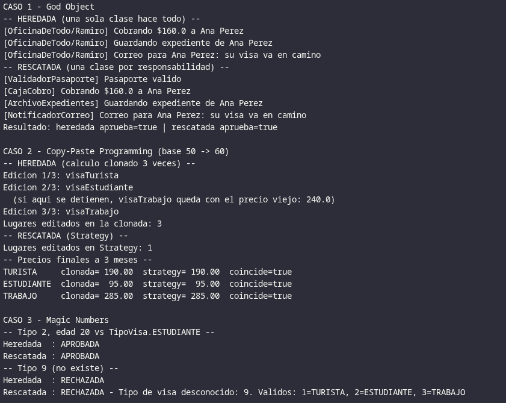
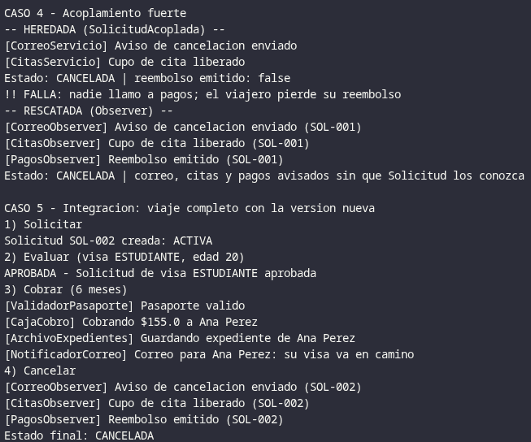

# Oficina de Visas 

## Estructura de paquetes

| Paquete | Contenido |
|---|---|
| `consulado.legacy` | Código heredado (los 4 antipatrones), solo para comparar |
| `consulado.tramite` | `ValidadorPasaporte`, `CajaCobro`, `ArchivoExpedientes`, `NotificadorCorreo`, `TramiteVisa` |
| `consulado.tarifas` | `TarifaStrategy`, 3 estrategias, `TarifaBase`, `CalculadoraTarifas` |
| `consulado.evaluacion` | `TipoVisa` (enum), `EvaluadorDeSolicitudes`, `ResultadoEvaluacion` |
| `consulado.cancelacion` | `Solicitud` (Subject), `SolicitudObserver`, 3 observers, `EstadoSolicitud` |
| `consulado.reporte` | `TablaAntipatrones` |

## Output

## Cacería de antipatrones

| Fragmento | Antipatrón | Síntoma | Consecuencia |
|---|---|---|---|
| La ventanilla de Ramiro | God Object | Una sola clase valida el pasaporte, cobra, guarda el expediente y envía el correo. | Viola la responsabilidad única: no se puede probar ni cambiar una tarea sin tocar las demás, y si la clase falla (Ramiro se enferma) se detiene todo el consulado. |
| La tarifa clonada | Copy-Paste Programming | El mismo cálculo (`50 * meses + 10`) está copiado en 3 métodos con cambios mínimos (×0.5, ×1.5). | Un cambio o corrección debe repetirse en cada copia; si se olvida una, queda con el precio viejo (pasó al subir la tarifa base). |
| Los números misteriosos | Magic Numbers | Valores sin nombre en el código: `tipo == 3`, `0.5`, edades `17`, `31`, `66`. | Resta legibilidad y nadie sabe qué significan ni si son correctos; un tipo inexistente se rechaza. |
| La cancelación en cadena | Acoplamiento fuerte | `SolicitudAcoplada` crea con `new` sus 3 servicios y los llama a mano uno por uno. | Cualquier cambio en un servicio o un aviso nuevo obliga a editar la solicitud, y es fácil olvidar uno. |

## Cómo se evita caer de nuevo en los antipatrones

Cada clase tiene una sola razón para cambiar (validar, cobrar, archivar, notificar), y `TramiteVisa` solo coordina el orden, sin hacer ese trabajo directamente. El precio base vive en un único objeto `TarifaBase` y el subtotal se calcula en un solo lugar, de modo que cada tipo de visa solo aporta su `TarifaStrategy`. Los números y textos sueltos se reemplazaron por el enum `TipoVisa` y por constantes con nombre, y los tipos inválidos se rechazan con un mensaje claro. Finalmente, `Solicitud` solo conoce la interfaz `SolicitudObserver`: agregar un aviso nuevo es crear un observer y registrarlo, sin tocar la solicitud ni los demás servicios, logrando una arquitectura que posibilita escalar el sistema a futuro.

